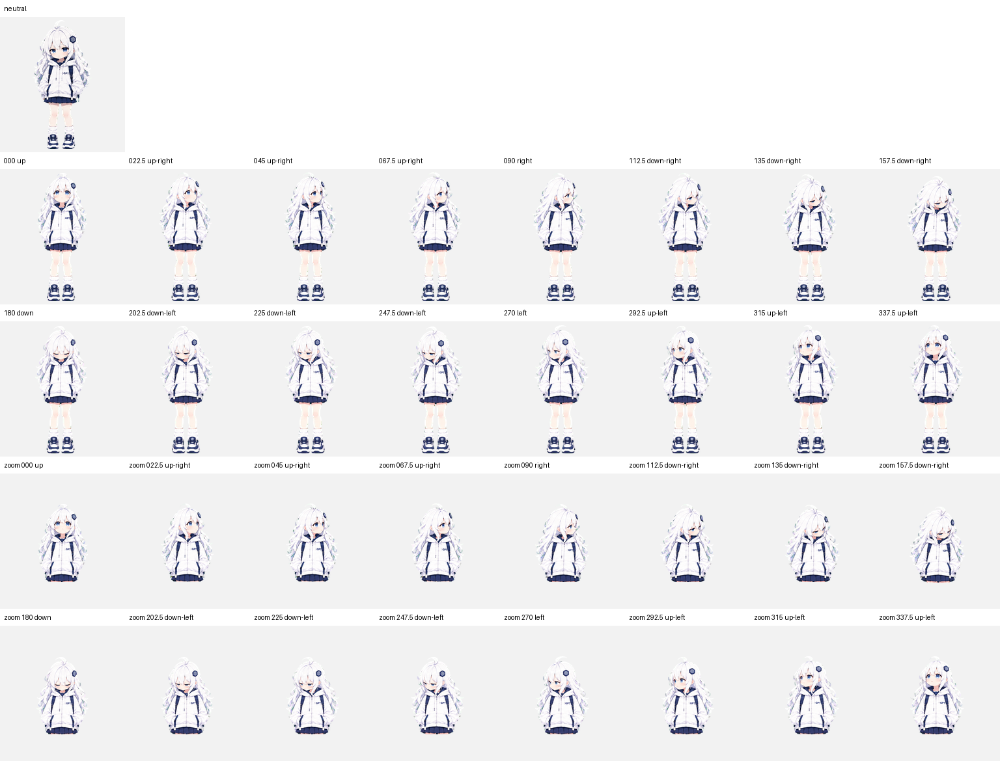

# Codex Pet

## Lumi

“Lumi” 来自 luminous，意为明亮、发光；这个名字对应角色的白色长发、蓝色眼睛和清爽的蓝白配色，也足够短，适合作为宠物名称。

Lumi 是一个面向 Codex 的自定义动画宠物：白发蓝眼，穿着蓝白连帽外套，整体风格轻盈而清爽。

项目提供透明背景的 v2 精灵图，尺寸为 1536 × 2288 像素，按 8 列 × 11 行排布，包含九组状态动画和 16 个注视方向。仓库同时收录动画配置、校验记录及预览图。

## 动画资源

- [精灵图](lumi/run/final/spritesheet-extended.webp)
- [动画配置](lumi/run/final/spritesheet-extended.json)
- [校验记录](lumi/run/final/validation-extended.json)

## 动作预览

| 动作 | 预览 |
| --- | --- |
| 待机（idle） |  |
| 向右移动（running-right） |  |
| 向左移动（running-left） |  |
| 挥手（waving） |  |
| 跳跃（jumping） |  |
| 沮丧（failed） |  |
| 等待（waiting） |  |
| 工作中（running） |  |
| 检查（review） |  |

### 方向预览

